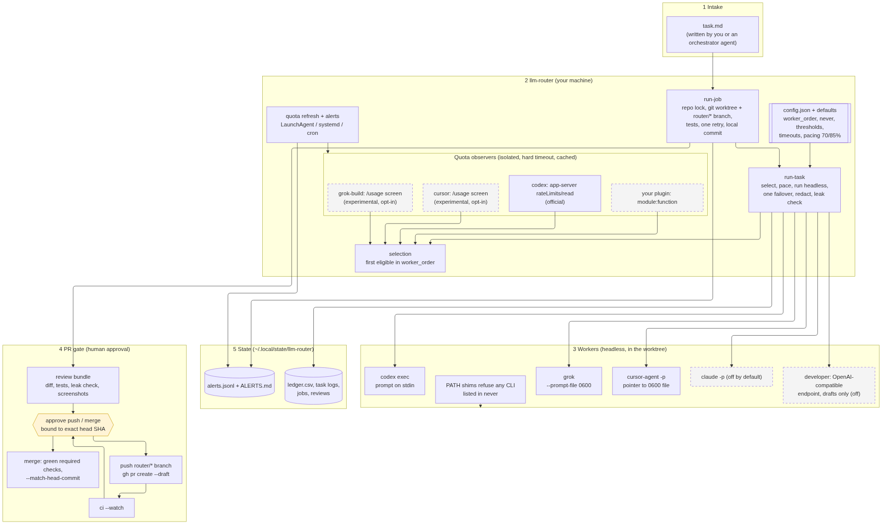
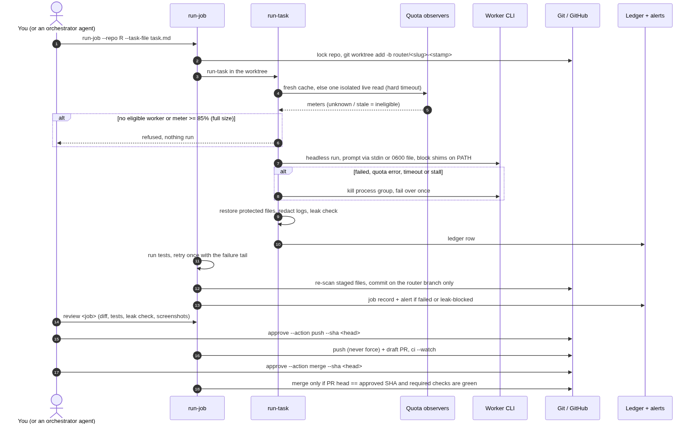

# Dynamic LLM Router

[](https://github.com/ovhirup/dynamic-llm-router/actions/workflows/ci.yml)

**Bring any worker. You choose and rank your coding workers; there is no default order.**
Built-in adapters and config-defined adapters let you use any CLI.
`llm-router` picks a worker (Codex, Grok Build, Cursor, optionally Claude Code or a local model) based on
each tool's *live* usage meter, runs the task headless in a throwaway git worktree, tests it, leak-checks it,
commits it on a `router/*` branch and then stops. Nothing is pushed or merged until a human approves the
exact commit.

It is built for people who pay for several AI coding subscriptions and want to spend each pool evenly
without babysitting terminals, and without ever leaking a private repo name or key into a public PR.

> Status: alpha (0.4). macOS and Linux. Python 3.10+, no third-party dependencies.
> Works with Codex, Grok, Cursor and Claude Code CLIs; not affiliated with or endorsed by any of them.



## What it does

| Step | Command | What happens |
|------|---------|--------------|
| Pick | `llm-router select` | Walks `worker_order`, reads each meter (fresh cache first), returns the first worker with fresh evidence below its threshold. Unknown or stale = ineligible. |
| Run | `llm-router run-task` | Runs one task headless in a clean checkout: pacing (warn 70%, refuse full-size work at 85%), hard timeout + output-stall watchdog, one failover, log redaction, leak check. Never commits. |
| Job | `llm-router run-job` | Locks the repo, creates a worktree on a new `router/<slug>-<stamp>` branch, runs the task, runs your tests, retries once with the failure tail, re-scans what will be committed, commits locally. Your main checkout is never touched. |
| Meters | `llm-router quota refresh --once`, `status`, `alerts` | Background refresh (LaunchAgent / systemd / cron), 70% / 85% / stale / CLI-version alerts, a status table. |
| Gate | `review`, `approve`, `deny`, `push`, `ci`, `merge` | Evidence bundle, approvals bound to job + action + exact head SHA (expire, single use), push without force, draft PR, CI watch, merge only when the PR head is the approved SHA and required checks are green. |
| Publish check | `llm-router scan [path] [--history]` | Leak-scan a tree (and optionally its whole history) for secrets and your private terms before you publish it. |



## Safety model

- **Unknown means no.** A meter that is missing, stale, malformed, future-dated or unparseable makes that
  worker ineligible; the router never guesses a number. A worker with no observer is ineligible unless you
  list it in `unmetered_workers` (it then runs unpaced, with a warning).
- **Private prompt delivery by default.** Task text goes to the worker on stdin (`codex exec -`), via a 0600 `--prompt-file`
  (grok) or as a short pointer to a 0600 file inside the checkout's `.git` dir (cursor-agent). Command templates
  are linted at load: `{prompt}` requires explicit `arg` delivery; credential flags and inline secrets are rejected. Arg delivery warns that the process list exposes task text.
- **Denylist with teeth.** Any CLI listed in `never` is refused as a worker *and* shadowed on the worker's PATH by
  a shim that logs and refuses the call, so a worker cannot spawn it either. Configured env prefixes
  (default `ANTHROPIC_`, `CLAUDE_`, `LITELLM_`) are stripped from worker environments; a worker can keep its
  own with `run_task.env_keep_prefixes` (default: `claude` keeps `ANTHROPIC_`/`CLAUDE_`), and
  `workers.<name>.env.allow` restricts a worker to an explicit allowlist.
- **Leak gate.** Every run, commit and push is scanned: vendor key shapes (OpenAI, Anthropic, xAI, GitHub,
  Slack, AWS, Google, JWT, PEM, bearer), `.env`-style secret assignments, quoted secret literals, and your
  private terms file. A hit blocks the commit/push and keeps the files for review; nothing is deleted.
  Public repos also get a full-file grep of every changed file and the branch name.
- **Low false positives.** Ordinary code is not a secret: JSX `key={…}`, `event.key`, Swift `forKey:`,
  `CodingKeys`, `let key = …` and unquoted type annotations are not flagged; untracked files that git ignores
  and vendor/build dirs (`node_modules`, `.venv`, `dist`, `Pods`, `DerivedData`, …) are skipped.
- **Never force, never bypass.** No force pushes, no `--admin`, no `--auto`, no branch deletion, never pushes
  the base branch. Only `router/*` branches are pushed or merged.
- **No credentials touched.** The router never reads auth/token files, keychains or cookies, never calls
  undocumented billing endpoints and never triggers paid top-ups. API keys (for the optional `developer` worker)
  come only from an env var you name.
- **Hang-proof meters.** Every observer runs in a child process in its own session with a hard wall-clock
  timeout; a hung CLI is killed with its whole process group and the reading becomes `unknown`.

See [SECURITY.md](SECURITY.md) for the threat model and how to report issues.

## Install

```bash
pipx install git+https://github.com/ovhirup/dynamic-llm-router   # or: pip install -e . in a venv
llm-router init       # interactive detection and worker ordering; Claude opt-in defaults No
llm-router doctor     # validates config, finds binaries and observers; runs no worker
llm-router paths      # where config and state live
```

The worker CLIs (`codex`, `grok`, `cursor-agent`, `claude`) are **not** bundled; install and log in to the ones you
use. They are found on `PATH`, or pinned with `binaries` in the config.

## Configuration

Packaged defaults ([`src/llm_router/default_policy.json`](src/llm_router/default_policy.json)) are deep-merged
with your config. Nothing personal ships in the package.

| What | Where (first match) |
|------|---------------------|
| Config file | `$LLM_ROUTER_CONFIG`, else `<config dir>/config.json` |
| Config dir | `$LLM_ROUTER_CONFIG_DIR`, else `$XDG_CONFIG_HOME/llm-router`, else `~/.config/llm-router` |
| State dir (caches, ledger, logs, worktrees) | `$LLM_ROUTER_STATE_DIR`, else `$XDG_STATE_HOME/llm-router`, else `~/.local/state/llm-router` |
| Per-repo settings (`test_cmd`, remote, required checks…) | `<config dir>/repos.json` |
| Private terms for the leak gate | `<config dir>/private_terms.txt` (one per line; keep it out of git) |

Minimal `config.json`:

```json
{
  "worker_order": ["codex", "grok-build", "cursor"],
  "never": ["claude"],
  "quota": {
    "grok-build": {"enabled": true},
    "cursor": {"enabled": true}
  },
  "timezone": "local"
}
```

Examples: [`examples/config.example.json`](examples/config.example.json),
[`examples/repos.example.json`](examples/repos.example.json),
[`examples/private_terms.example.txt`](examples/private_terms.example.txt). Full reference:
[docs/configuration.md](docs/configuration.md).

## Worker adapters

| Worker | Runs | Prompt delivery | Quota meter | Default |
|--------|------|-----------------|-------------|---------|
| `codex` | `codex exec -C <cwd> -s workspace-write -c approval_policy=never -c notify=[] -` | stdin | `codex app-server` `account/rateLimits/read` (official) | no default order; meter enabled |
| `grok-build` | `grok --prompt-file <0600 file> --cwd <cwd> --always-approve --no-subagents` | file | `/usage` screen of `grok dashboard` (experimental) | not ranked; meter off until enabled |
| `cursor` | `cursor-agent -p --force --trust --workspace <cwd> <pointer>` | pointer | `/usage` screen of `cursor-agent` (experimental, consulted only as fallback) | not ranked; meter off until enabled |
| `claude` | `claude -p --permission-mode acceptEdits` | stdin or pointer | `/usage` screen (experimental, unverified layout) | built-in, **off**, never auto-ranked; explicitly opt in |
| `developer` | POST to an OpenAI-compatible endpoint (e.g. local LiteLLM/Ollama) | request body | none | **off**: drafts only, `developer.enabled` + `endpoint` |

These flags give the worker autonomous write access inside the worktree. Review them in the config before
first use. Templates are plain argv lists in `run_task.commands`; placeholders are `{codex}`, `{grok}`,
`{cursor}`, `{claude}`, `{cwd}`, `{repo}`, `{prompt_file}`, `{prompt_pointer}`.
Block Claude with `"never": ["claude"]`: this refuses `claude`, `claude-code` and custom workers whose executable basename is either, and shadows both on worker PATHs.

### Quota observers

An observer is any `module:function` returning
`{"evidence": {...} | null, "status": "ok" | "unknown", "reason": ..., "cli_version": ...}`; set it with
`quota.<worker>.observer`. The Grok Build and Cursor observers drive the vendor's **interactive usage screen**
in a pseudo-terminal (no prompt is sent, no model is called) and parse it strictly. They are opt-in and
labelled experimental: a UI change makes them return `unknown` (the worker becomes ineligible) rather than a wrong
number, and you are responsible for complying with each vendor's terms. Details:
[docs/observers.md](docs/observers.md).


## Bring your own worker

Add a CLI using `workers.<name>`; explicitly list unmetered workers when there is no usage reader:

```json
{
  "worker_order": ["aider"],
  "workers": {"aider": {
    "command": ["aider", "--yes-always", "--no-auto-commits", "--no-gitignore", "--message-file", "{prompt_file}"],
    "prompt_delivery": "file"
  }},
  "unmetered_workers": ["aider"]
}
```

Check flags against your installed CLI version. See [worker examples](docs/workers.md) for aider,
aider with Ollama, opencode (argv privacy warning), and a custom quota command.

`llm-router init` detects binaries using PATH lookup only; it never runs them. In a terminal it asks for
preference order, explicit Claude opt-in (default No), and experimental meter opt-in (default No).
For scripts use `llm-router init --non-interactive --workers codex,aider --never claude --meters codex`.
Without `--workers`, non-interactive init fails and lists detected CLIs. `--dry-run` prints configuration
without writes; `--force` backs up config.json to `config.json.bak-<timestamp>` before replacement.
Existing repos.json and private_terms.txt are always preserved. Workers without enabled meters are marked
unmetered and are not paced. Empty `worker_order` returns `worker: null`, `no_workers_configured`, with an init hint.

### `--worker` overrides

Applies equally to `run-task` and `run-job`; a forced worker has no failover.

| Rule | Forced `--worker X` behavior |
|------|-----------------------------|
| `worker_order`, `ineligible`, `consult: fallback` | Ignored; any defined worker can be forced, including outside the order. |
| `never`, including executable aliases | Refused, exit 3: `X is in never; remove it from never to use it`. |
| Full-size meter at `refuse_full_percent` | Refused; pacing cannot be overridden. |
| Unknown meter for full-size work | Refused unless X is in `unmetered_workers`. |
| Draft-size unknown meter | Allowed with an unpaced warning. |
| Forced worker fails | No failover to another worker. |

## Job flow

```bash
llm-router run-job --repo ~/code/my-app --task-file task.md      # worktree + branch + tests + local commit
llm-router review  my-app-20261018-101500                        # evidence bundle in <state>/logs/reviews/
llm-router approve my-app-20261018-101500 --action push  --sha 1a2b3c4d
llm-router push    my-app-20261018-101500                        # never force; opens a DRAFT PR
llm-router ci      my-app-20261018-101500 --watch
llm-router approve my-app-20261018-101500 --action merge --sha 1a2b3c4d
llm-router merge   my-app-20261018-101500                        # PR head must equal the approved SHA
llm-router jobs; llm-router cleanup --older-than 7d --dry-run
```

`run-task` exit codes: `0` ok, `1` worker/tests failed or leak-blocked, `3` refused before anything ran.
All commands print JSON.

## Quota pacing

- Each meter has a `usage_threshold_percent` (default 85): at or above it the worker is not selected.
- `run_task.pacing`: a warning at `warn_percent` (70) and a refusal of new **full-size** work at
  `refuse_full_percent` (85), including for a forced `--worker`. Draft-size runs may proceed with a warning.
- Cached readings are valid for `freshness_seconds`; `quota refresh` keeps them warm (codex every 5 min,
  grok every 15 min, cursor hourly by default) with exponential backoff on failures, and skips a pool at 100%
  until its reset. A forced worker reads only its own meter.
- Alerts (`<state>/logs/alerts.jsonl` + `ALERTS.md`): 70% warn, 85% stop, meter stale > 30 min, CLI version
  change, failed or leak-blocked job, CI result. They are deduplicated per meter, level and reset period.
  Optional macOS banner: `alerts.macos_notification`.

## Scheduling the quota refresh (optional)

- **macOS**: `llm-router install-agent` prints the LaunchAgent plist and the `launchctl` command (dry run);
  `install-agent --yes` writes and loads it. `uninstall-agent --yes` removes it.
- **Linux**: a systemd user timer ([contrib/systemd](contrib/systemd)) or cron:
  `*/5 * * * * llm-router quota refresh --once >/dev/null 2>&1`. See [docs/scheduling.md](docs/scheduling.md).

## Development

```bash
python -m venv .venv && .venv/bin/pip install -e .
cd tests && ../.venv/bin/python -m unittest discover -t . -s .
```

Tests use fake workers, fake `gh`, fixture screens and temp git repos only; they never call a real agent CLI
or the network. See [CONTRIBUTING.md](CONTRIBUTING.md) and [CHANGELOG.md](CHANGELOG.md).

## License

MIT, see [LICENSE](LICENSE). Vendor CLIs are not bundled or redistributed.

### Optional Stackwich verification

Any CLI worker can opt into the same in-session plan → execute → verify → review contract:

```json
{"workers": {"sample": {"command": ["sample-worker"], "stackwich": {"enabled": true, "supported": true}}}}
```

Both booleans default to false. Declare `supported` only for an adapter that can follow the
protocol. Enabled unsupported workers are marked `unsupported`, warn, and run normally.
Disabled workers receive no protocol prompt. Worker order and Claude Code enrollment remain opt-in.

A supported worker writes `.router-stackwich/report.json` with this structure:

```json
{"plan":{"files":["out.txt"],"steps":["Create out.txt"],"verification":[{"command":"test -f out.txt","expected":"exit 0"}]},"execute":{"changed_files":["out.txt"]},"verify":{"commands_run":[{"command":"test -f out.txt","exit_code":0}],"scope_check":"PASS","gate":"PASS"},"review":{"verdict":"APPROVE","items":[]},"cycles":1}
```

`run-job` requires PASS, APPROVE, exact planned/observed product paths, successful command evidence,
and a real configured router test command that passes. The router never executes report-provided
commands. Correction stays pinned to the same worker, with a maximum of two cycles regardless of
ordinary retry settings; `cycles` must match the current attempt. Unresolved failures become
`blocked_by_stackwich` and keep the worktree by default. Reports are excluded from commits and
retained in kept worktrees; other files in that directory remain subject to scope checks.

The final gate rejects changes to report evidence or product contents during router tests,
unexpected worker commits, and staged scope mismatches. Verified commits include
`Stackwich: verified`; summaries retain sanitized evidence and validation errors. These stages run
within the worker session, with independent router tests and scope checks; this is not independent
model review. Existing publication approvals still apply.
