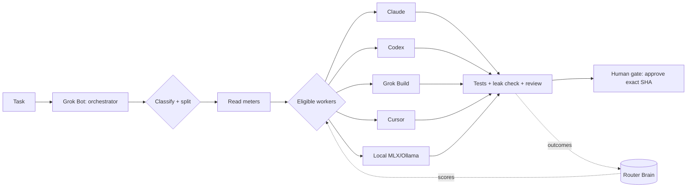
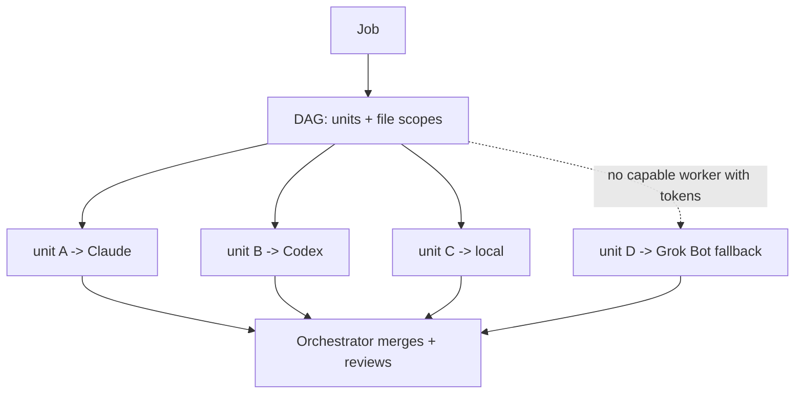
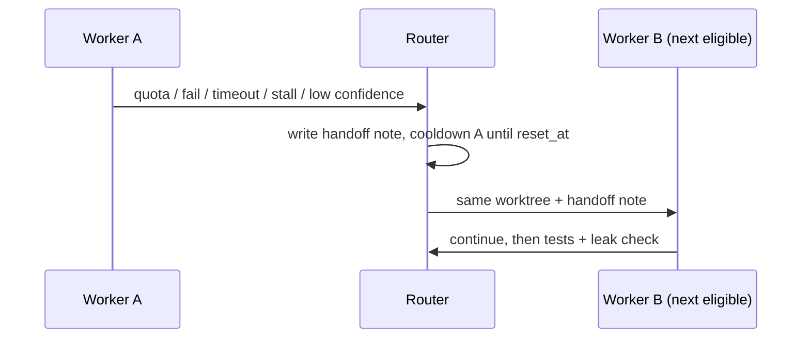

# Dynamic LLM Router: master routing strategy

Status as of 31 Oct 2026. This is the single source of truth for how DLR picks, runs, switches and learns. Detail docs:
`STRATEGY_WORKERS_FALLBACK.md` and `ROUTER_BRAIN.md` (branch `grokbot/strategy-workers-fallback`), plus `workers.md` and `configuration.md`.

Legend: **[Shipped 0.4.0]** is on main. **[In review]** has a local branch awaiting approval. **[Planned]** is an open issue.

## 1. Worker order (user-confirmed 31 Oct 2026)

**Claude (personal Claude Pro) > Codex > Grok Build > Cursor > local models (Nativ MLX / Ollama).**
Grok Bot is the orchestrator: it classifies and splits tasks, dispatches, reviews, and is the last-resort fallback. It does the work itself only when no worker is eligible.

- [Shipped 0.4.0] `worker_order` in config. There is no built-in default; the user ranks workers.
- [In review #22] Claude is used only when `~/.claude.json` shows a personal account (opt-in via `claude_account_check`).
- [In review #14] When local aider-ollama fails, the job JSON now records `failure_reason`. The crash itself is a scipy 1.15.3 load error on macOS 27; reinstall aider with `scipy>=1.16`.

## 2. Selection rules

| Rule | Status |
|---|---|
| Fresh meters only. Unknown or stale (>30 min, or >24 h for manual readings) = ineligible | Shipped 0.4.0 (manual meters: In review #23) |
| Normalised `MeterRecord` (worker, window, percent, reset_at, read_at, source) | In review #21 |
| Warn at 70%; 85% stops full-size work (drafts are still allowed) | Shipped 0.4.0 |
| Alerts at 85% / 100% / stale, plus a daily summary (`python -m llm_router.meters summary`) | In review #24 (0.4.0 already alerts at 70/85/stale) |
| One failover per job, then stop and report | Shipped 0.4.0 |
| Selection consumes MeterRecords from every source | Planned |

## 3. Parallel dispatch [Planned #35–#40]

- Every eligible worker that has tokens gets work. No capable model sits idle while the queue is non-empty.
- Jobs are decomposed into a task DAG of independent units with explicit file scopes (#36). Units run in separate worktrees and are merged by the orchestrator.
- Task class to worker matching: feature/bugfix go to strong workers; mechanical work goes to Codex, Cursor or local; drafts go to local; review goes to Grok Bot or Claude. A `design` class with design plugins comes later (#90).
- A worker that is ahead of its weekly pace drops a rank rather than being banned.
- **Grok Bot is not in the parallel pool.** Only the workers (Claude, Codex, Grok Build, Cursor, local) are dispatched in parallel. Grok Bot orchestrates, merges and reviews, and is selected as a worker for a unit only when no worker is both capable of that unit and has enough tokens left. When several units have no eligible worker, Grok Bot takes them one at a time.

## 4. Token optimisation [Planned #91, #92]

- Decision ladder per step: **rules in code (no model)**, then **cheap tier** (Haiku-class / local qwen) for search, sort, triage, extraction and pass/fail, then **strong tier** for planning and hard bugs, then **human** for anything irreversible.
- Claude prompts default to **medium effort**; high effort only for hard tasks. Context is fenced and "think step by step" filler is dropped (#92).
- A **100K-token prompt guard**: larger prompts are split or summarised before dispatch.
- **Cost per task** is logged (worker, tier, tokens, meter delta) and feeds the Router Brain.

## 5. Switching logic [Partly shipped; handoffs Planned #41–#45]

Triggers: quota hit (429 or limit), failure, timeout, output stall, low confidence (the worker says it is unsure, or tests fail twice).

- [Shipped 0.4.0] Hard timeout, stall watchdog, and one failover that retries with the failure tail.
- [Planned] **Handoff note:** goal, files touched, current diff summary, test status and last failure, decisions made, next steps, and the meter reason for the switch. Context is preserved by keeping the same worktree and branch.
- Reroute goes to the next *eligible* worker in order. If none is eligible, Grok Bot finishes the job or reports it.

## 6. Router Brain [Planned #46, #93, #67, #61]

- **Verified-notes wiki (#93):** `raw/` holds immutable job logs, handoffs and research. `wiki/` holds maintained notes. There are three steps: collect, update, and a **nightly audit** that expires stale or unverified facts. Routing reads only verified notes.
- **Self-learning (#67):** per class × worker outcome scores (pass rate, retries, cost, time) adjust ranks within the user's order. There is no fine-tuning.
- **Evaluation harness (#61):** a fixed task set that every routing or prompt change must pass before it ships. It ranks above self-learning.
- **Model news (#52) and plugins (#73):** new models or tools enter only through the eval harness.

## 7. Human gates (unchanged) [Shipped 0.4.0; #81 Planned]

- Workers never push, merge or approve. Every job ends as a local commit on a `router/*` branch.
- Push and merge need an approval bound to job + action + exact head SHA (single use, expiring). Merge also needs green required checks.
- Notch actionable approvals (#81) add a faster way to say yes; the binding rules stay the same.
